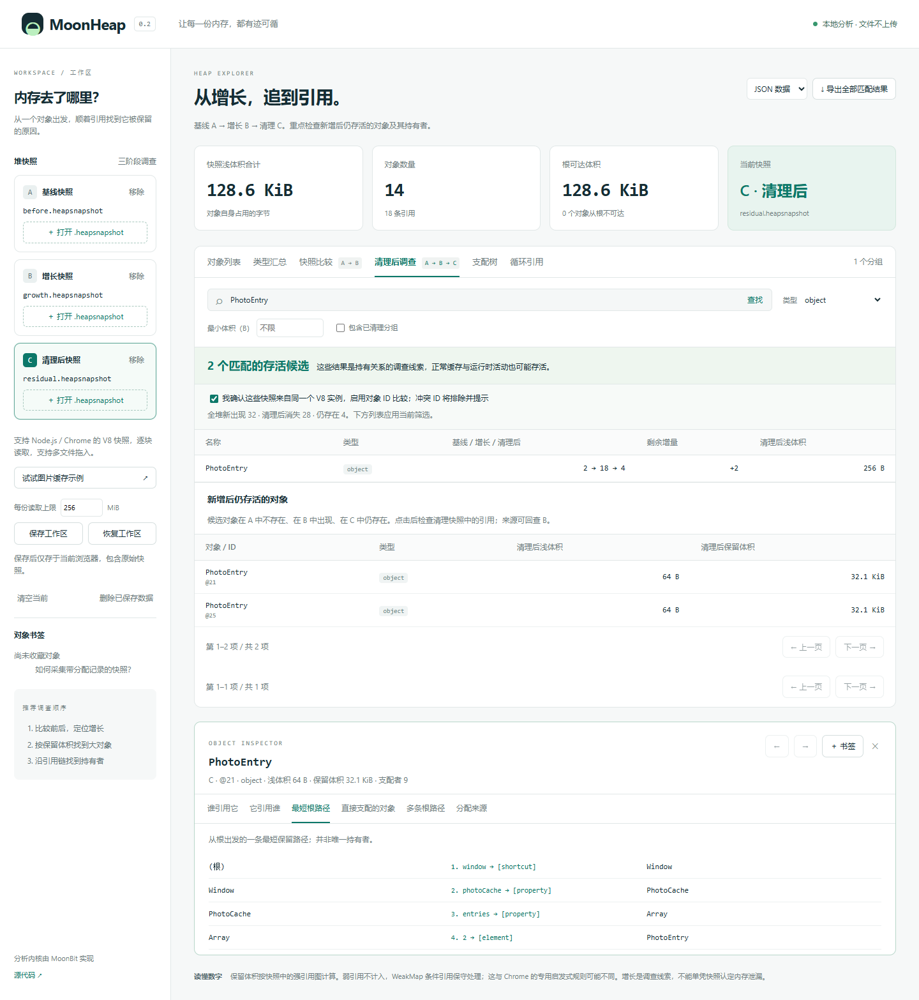

# MoonHeap

**找出对象被谁保留，解释程序为什么越来越占内存。**

MoonHeap 是用 MoonBit 编写的离线 V8 堆快照分析库，附带命令行工具和本地网页。它把「采集基线 → 复现增长 → 清理 → 找出存活对象 → 追查持有者和分配位置 → 导出证据」串成完整调查流程。解析、引用图、支配关系、保留体积、差分和报告均由 MoonBit 实现。

[](https://github.com/white-bear233/MoonHeap/actions/workflows/ci.yml)
[下载发行版](https://github.com/white-bear233/MoonHeap/releases) · [Mooncakes](https://mooncakes.io/docs/white-bear233/moonheap) · [API](docs/API.md) · [计算含义](docs/SEMANTICS.md) · [验证记录](docs/VALIDATION.md) · [申报稿](docs/PROPOSAL.md)



## 已完成的功能

| 调查步骤 | 功能 |
|---|---|
| 采集与导入 | 通用 Node 场景采集；分配跟踪；三份快照与 SHA-256 来源记录；真正逐块解析与读取进度 |
| 定位大对象 | 精确 UInt64 ID；名称、类型、大小及可达性筛选；浅体积和保留体积排序 |
| 追查引用 | 入边/出边、最短根路径、多条根路径、循环引用组及成员 |
| 分析持有关系 | 支配树导航、祖先路径、保留体积分布图；共享对象不重复加总 |
| 比较变化 | 聚合比较；同 isolate 对象匹配；自身大小及保留体积变化；两张表独立分页 |
| 清理后验证 | A 基线、B 增长、C 清理；筛出 A 不存在、B 出现、C 仍存在的对象 |
| 查找来源 | 对象源码位置、分配调用栈；经确认后可回查增长快照的分配记录 |
| 保存与交付 | 对象历史/书签、浏览器工作区保存恢复、全部匹配行的 JSON/CSV/HTML 报告 |

报告超限会报错，不静默截断。快照只在本机处理；保存工作区是明确操作，会将原始文件存入当前浏览器。

**计算边界：**保留体积采用明确的强引用图策略，不等于进程 RSS，也不自动判定泄漏。WeakMap 条件边保守处理，详见[语义说明](docs/SEMANTICS.md)。输入是 V8 快照，不是 MoonBit 原生运行时堆，也不支持 JVM HPROF 或采样型 .heapprofile。

## 三分钟体验

推荐下载 [MoonHeap v0.2.0](https://github.com/white-bear233/MoonHeap/releases/tag/v0.2.0) 的预编译 ZIP。安装 Node.js 22+，解压后进入目录运行：

```sh
node scripts/serve.mjs
```

打开 [本地界面](http://127.0.0.1:4173)，点击「加载缓存增长示例」：

1. 自动加载三份合成快照：图片条目数量为 2 → 18 → 4；A → B 的 PixelBuffer 浅体积增加 512 KiB。
2. 确认示例来自同一快照序列，切换「清理后调查」，搜索 PhotoEntry，类型选择 object：有 2 个新增后仍存活的条目。
3. 点击候选，查看清理快照中的根路径，定位 Window → PhotoCache → Array。
4. 体验支配树、书签、保存恢复，再导出 HTML 报告。来源信息缺失时会明确说明；带分配跟踪的真实示例见下节。

从源代码开发，需要 MoonBit 工具链（本版验证版本为 moonc v0.10.20+65efd5b93）：

```sh
git clone https://github.com/white-bear233/MoonHeap.git
cd MoonHeap
npm run build
npm run demo
```

运行界面无需安装 npm 运行时依赖。完整演示步骤见 [DEMO.md](docs/DEMO.md)。

## 采集自己的 Node 场景

准备一个模块，导出必需的 `exercise(context, iteration)`，以及可选的 `setup()` 和 `cleanup(context)`。三个函数均支持 async。setup 返回的 context 会由采集器持有，cleanup 应清除其中希望释放的引用。参考 [cache-scenario.mjs](examples/cache-scenario.mjs)。

```sh
node bin/moonheap.mjs capture --scenario examples/cache-scenario.mjs --output-dir work/my-capture --iterations 2 --allocation-traces --json
node bin/moonheap.mjs investigate work/my-capture/before.heapsnapshot work/my-capture/growth.heapsnapshot work/my-capture/cleanup.heapsnapshot --manifest work/my-capture/capture.json --exclude-conflicts --query MoonHeapCapturedEntry --kind object --json
```

该真实场景对象数是 **0 → 16 → 1**：应找到唯一残留对象，再查询引用与分配来源。输出目录已有同名采集文件时会拒绝覆盖。默认采集超时 120 秒，可用 `--timeout` 调整毫秒数。

将三份文件依次放入网页 A/B/C，确认同一 V8 实例后调查。清理快照偶尔不保留分配跟踪 ID；网页会在确认身份后回查 B，并注明来源。

采集会暂停被测进程并消耗额外内存；在专用测试环境复现。详见 [Node 官方说明](https://nodejs.org/api/v8.html#v8writeheapsnapshotfilenameoptions)。Chrome 可在 Memory 面板保存 Heap snapshot，分配栈取决于采集时是否启用跟踪。

## 命令行与完整报告

```sh
node bin/moonheap.mjs summary examples/growth.heapsnapshot
node bin/moonheap.mjs nodes examples/growth.heapsnapshot --kind object --min-retained 32768 --limit 10
node bin/moonheap.mjs node examples/shared.heapsnapshot --id 9007199254740993
node bin/moonheap.mjs refs examples/growth.heapsnapshot --id 7
node bin/moonheap.mjs paths examples/shared.heapsnapshot --id 7 --max-paths 5 --json
node bin/moonheap.mjs tree examples/growth.heapsnapshot --id 7
node bin/moonheap.mjs cycles examples/growth.heapsnapshot
node bin/moonheap.mjs diff examples/before.heapsnapshot examples/growth.heapsnapshot --same-isolate --status retention_changed --json
node bin/moonheap.mjs report examples/growth.heapsnapshot --view nodes --format html --output work/objects.html
node bin/moonheap.mjs report examples/before.heapsnapshot examples/growth.heapsnapshot examples/residual.heapsnapshot --view investigate --same-isolate --format csv --output work/survivors.csv
```

完整命令：summary、validate、nodes、groups、node、refs、path、paths、source、tree、cycles、cycle、dominated、diff、investigate、report、capture。运行 `--help` 查看所有参数。

默认每份文件上限 **256 MiB**，`--max-mib` 可设 1–1024；网页也可调整。节点、边、元数据和计算仍有独立预算，不保证上限内的所有复杂图都能在任意机器处理。实际内存大于文件大小。

身份比较必须来自同一 V8 isolate。`--same-isolate` 是调用者声明；`--manifest capture.json` 额外验证采集记录的文件大小与哈希，不能将任意文件名当作来源证明。默认跨进程只做聚合比较。若真实快照中同 ID 的类型/名称矛盾，CLI 默认拒绝身份比较；已确认来源时可用 `--exclude-conflicts` 排除这些 ID，并在结果中查看排除数量。网页采用排除并提示的方式；聚合统计仍保留所有对象。

`report` 收集全部匹配行，忽略分页起点；每个结果列表默认最多 100000 行，可用 `--max-rows` 调整。文件存在时须明确传 `--force` 才覆盖。CSV 保护文本公式与精确 ID；HTML 自包含且不运行脚本。详见 [API](docs/API.md)。

## 作为 MoonBit 库

```sh
moon add white-bear233/moonheap@0.2.0
```

在调用包的 `moon.pkg` 中导入 `"white-bear233/moonheap" @heap`。小文本可用 `@heap.parse(input)`；逐块处理可用：

```moonbit
fn inspect_chunks(chunks : Array[String]) -> Unit raise @heap.HeapError {
  let decoder = @heap.Decoder::new()
  for chunk in chunks {
    decoder.feed(chunk)
  }
  let snapshot = decoder.finish()
  let analysis = snapshot.graph().analyze()
  for node in analysis.nodes(kind="object", limit=10).items {
    println("\{node.id}  \{node.name}  shallow=\{node.self_size}")
  }
}
```

UTF-8 字节解码由宿主负责；不要提前把整个文件读入字符串数组来模拟流式读取。三个后端共享核心 API，完整类型声明见 [pkg.generated.mbti](pkg.generated.mbti)。运行示例：`moon run cmd/main --target js`。

## 验证与项目交付

```sh
moon test --target js --deny-warn
moon test --target wasm-gc --deny-warn
moon info
moon fmt
npm run build
npm test
node scripts/benchmark.mjs
```

34 个 MoonBit 测试包含 150 个随机图的独立删除节点验证、增量解析、分配来源、多路径、循环、三阶段存活和跨页报告。Node 与浏览器测试验证真实清理及残留场景、65 MiB 逐块输入、错误恢复、保存恢复和完整导出。Linux CI 还验证 native 核心及 Node 22/24，详见 [VALIDATION.md](docs/VALIDATION.md)。

```text
快照字节流 → MoonBit Decoder → 引用图 / 支配树 / 来源索引
                           → 查询 / 比较 / 三阶段调查 / 报告
                           → 同一 JS 桥接 → Node CLI / Web Worker
```

[规划与验收](docs/PLAN.md) · [完整功能清单](docs/COMPLETENESS.md) · [更新记录](CHANGELOG.md)

相邻生态项目包括 [moon-pprof](https://github.com/mizchi/moon-pprof) 的采样/pprof 工具与 [moon-hprof](https://mooncakes.io/docs/clhhhhhh/moon-hprof) 的 JVM HPROF 解析。MoonHeap 提供 V8 对象引用图、支配保留分析及 MoonBit 可复用内核，检索依据与范围区别见[申报稿](docs/PROPOSAL.md)。

Apache-2.0 原创实现；使用 AI 辅助开发。格式、算法参考及第三方边界见 [ACKNOWLEDGEMENTS.md](ACKNOWLEDGEMENTS.md)。
